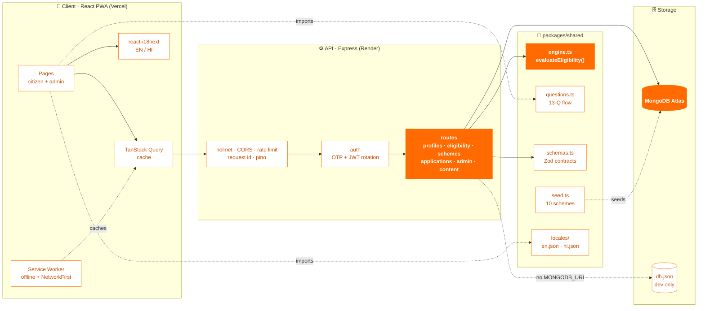
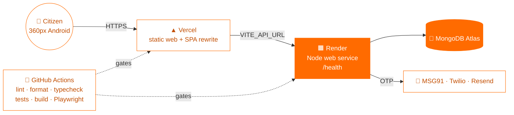
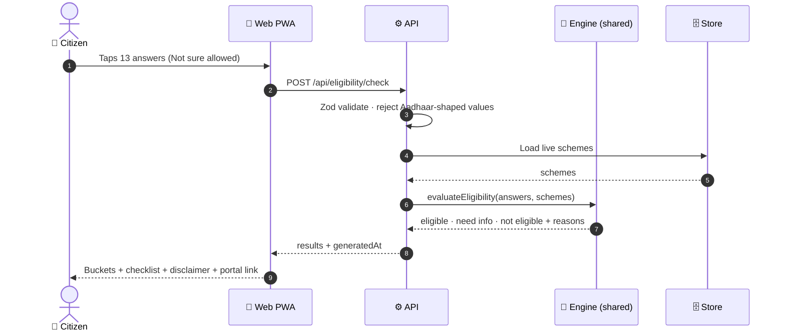
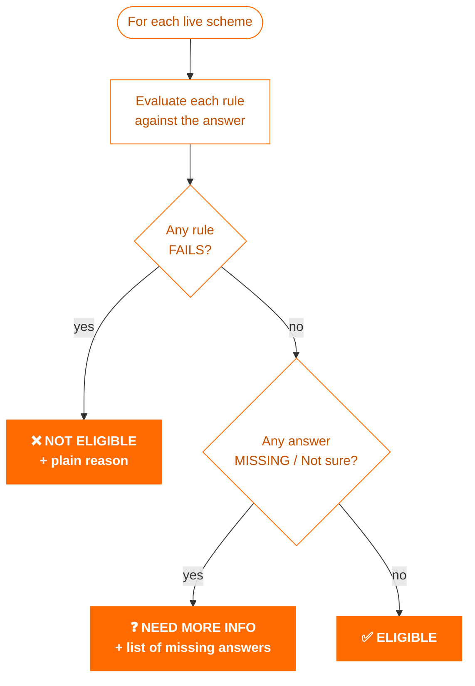
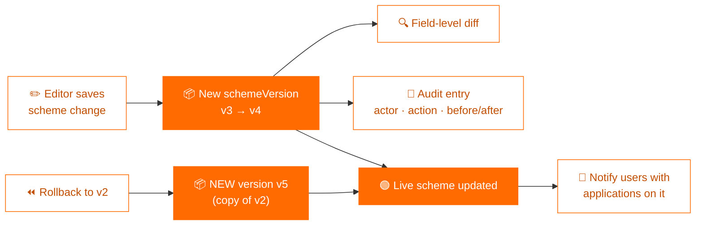

<div align="center">


<br/>


### 🧡 An independent, mobile-first guide to Indian central government benefits 🧡

**13 plain-language questions → a transparent list of schemes → the documents to carry → the official portal link.**

<sub>Not a government service. Never claims to be. No Aadhaar. No AI deciding your fate.</sub>

</div>

<br/>

> [!IMPORTANT]
> **Pramansetu is a guide. The official portal makes the final decision.**
> This line is rendered on every result screen, in the footer, on the About page and in the PWA manifest.

---

## 🔶 Contents

| | | |
|---|---|---|
| [⚡ The 10-second pitch](#-the-10-second-pitch) | [🏗️ Architecture](#️-architecture) | [🧠 Eligibility engine](#-eligibility-engine) |
| [🗂️ What is in the box](#️-what-is-in-the-box) | [🔁 Request flow](#-request-flow) | [🛠️ Admin and versioning](#️-admin-and-versioning) |
| [🧰 Stack](#-stack) | [🚀 Quick start](#-quick-start) | [🔐 Privacy and security](#-privacy-and-security) |
| [🔑 Demo accounts](#-demo-accounts) | [⚙️ Environment](#️-environment-variables) | [🧪 Testing](#-testing) |
| [♿ Accessibility and PWA](#-accessibility-and-pwa) | [☁️ Deployment](#️-deployment) | [🔌 API](#-api-overview) |
| [📏 Scope](#-scope-and-assumptions) | [✅ Data verification](#-data-verification) | [📁 Structure](#-project-structure) |

---

## ⚡ The 10-second pitch

```text
  ┌──────────────┐     ┌──────────────┐     ┌──────────────┐     ┌──────────────┐
  │  TAP 13 Qs   │ ──▶ │  RULE ENGINE │ ──▶ │   3 BUCKETS  │ ──▶ │  CARRY LIST  │
  │  (Not sure   │     │  pure TS,    │     │ ✅ Eligible  │     │  + official  │
  │   is OK)     │     │  no AI       │     │ ❓ Need info │     │  portal link │
  └──────────────┘     └──────────────┘     │ ❌ Not elig. │     └──────────────┘
                                            └──────────────┘
```

| 🧡 Citizen gets | 🤍 Team gets |
|---|---|
| Schemes they may qualify for, with a plain reason for each | Admin rule builder, no code deploy to change a scheme |
| A deduplicated document checklist | Every edit saved as a new version with field-level diff |
| "Not sure" → *need more info*, never a wrong rejection | Rollback that creates a **new** version, history is never rewritten |
| Hindi and English, one tap, persisted | Audit log of every write |

---

## 🗂️ What is in the box

<table>
<tr>
<td width="50%" valign="top">

### 🧑‍🌾 Citizen experience
- Signed-in home dashboard: counts, quick actions, family section
- Scheme library and detail pages
- 13-question check → review → calculating → results
- Per-scheme explanation and document checklist
- Compare, print and share
- Notifications and applications
- Family profiles with detail view (review and edit saved answers)
- Settings, onboarding, About / Privacy / Accessibility / Contact
- Offline page and 404

</td>
<td width="50%" valign="top">

### 🛡️ Admin panel
- Dashboard and scheme list
- Rule builder
- Version history, field-level diff and compare
- Rollback (as a new version)
- Question manager
- Translation editor
- User roles
- Audit log
- Contact inbox

</td>
</tr>
</table>

- 🌐 **Bilingual** — all strings live in `packages/shared/src/locales/{en,hi}.json`, with an admin-editable override layer in MongoDB.
- 📜 **10 real central schemes** across pensions, scholarships and welfare. Unconfirmed values are marked `VERIFY`.
- 💾 **Two storage modes** — file-backed JSON (zero setup) or MongoDB/Mongoose when `MONGODB_URI` is set.

---

## 🧰 Stack

| Layer | Choices |
|---|---|
| 🎨 **Web** | React 18 · Vite 6 · TypeScript strict · Tailwind CSS · React Router 6 · TanStack Query 5 · react-i18next · Framer Motion · Lucide · `vite-plugin-pwa` |
| ⚙️ **API** | Node.js · Express 4 · TypeScript · Zod · JWT access + refresh (rotating, hashed at rest) · helmet · CORS allowlist · rate limiting · pino |
| 🗄️ **Data** | MongoDB + Mongoose in production · file-backed store otherwise |
| 🧬 **Shared** | Pure TS types · question flow · rule engine · Zod schemas · seed catalogue · locale copy |
| 🧪 **Quality** | Vitest · Supertest · Testing Library · Playwright (Chromium + Pixel 5) · ESLint · Prettier |

---

## 🏗️ Architecture

### System map



### Layered view

```text
┌─────────────────────────────────────────────────────────────────────────┐
│ 🧡 PRESENTATION    React pages · Tailwind · Framer Motion · i18n · PWA  │
├─────────────────────────────────────────────────────────────────────────┤
│ 🤍 STATE & FETCH   TanStack Query · auth/check state · typed API client │
├─────────────────────────────────────────────────────────────────────────┤
│ 🧡 TRANSPORT       Express · helmet · CORS · rate limits · Zod gates    │
├─────────────────────────────────────────────────────────────────────────┤
│ 🤍 DOMAIN (shared) evaluateEligibility(answers, schemes)  ← PURE FN     │
├─────────────────────────────────────────────────────────────────────────┤
│ 🧡 PERSISTENCE     Store interface → MongoStore │ FileStore             │
└─────────────────────────────────────────────────────────────────────────┘
```

> [!TIP]
> The engine lives in `packages/shared`, so the exact same code is unit-tested and executed on the server. One source of truth, zero drift.

### Deployment topology



---

## 🔁 Request flow



---

## 🧠 Eligibility engine

> **Rule #1: No AI model ever decides, ranks, or explains eligibility.**
> The engine is a pure function of `(answers, schemes)`: no network, no model, no randomness.



| Bucket | Meaning | Triggered by |
|---|---|---|
| ✅ **Eligible** | Every rule passes | All answers present and matching |
| ❓ **Need more information** | Nothing failed, something unknown | One or more **Not sure** answers |
| ❌ **Not eligible** | At least one rule fails | A definite mismatch, reason shown |

**Guarantees**
- "Not sure" is **missing information, never a rejection**.
- Band comparisons are ordered: `gte: 60-79` includes `80plus`.
- Conditional questions appear only when relevant: `studyLevel` / `marks` (students), `ownsLand` (farmers), `maritalStatus` (women 18+).
- 54 shared tests lock the behaviour down.

---

## 🛠️ Admin and versioning



| Role | Can do |
|---|---|
| `viewer` | Read admin data |
| `editor` | Read + write schemes, questions, translations, contact |
| `admin` | Everything an editor can |
| `superadmin` | All of the above + **change user roles** |

Admin features: **Schemes** (filter, create, edit, publish/unpublish) · **Rule builder** (add, remove, reorder, mark `VERIFY`, edit bilingual copy) · **History / Compare** · **Questions** · **Translations** · **Users** · **Audit** · **Contact**.

---

## 🚀 Quick start

Requirements: **Node.js ≥ 20**, npm 10+. MongoDB is optional.

```bash
npm install
cp .env.example apps/api/.env
npm run dev
```

| Service | URL |
|---|---|
| 🌐 Web | http://localhost:5173 |
| ⚙️ API | http://localhost:4000 (health: `/health`) |

The API seeds the 10 schemes, translations, a super-admin and a demo citizen on first boot. Without `MONGODB_URI`, data persists to `apps/api/.data/db.json`.

> [!WARNING]
> Keep `ENABLE_DEMO_LOGIN=false` in any shared or deployed environment.

To use MongoDB, set `MONGODB_URI=mongodb+srv://...` in `apps/api/.env`.

---

## 🔑 Demo accounts

Development only. Never created when `NODE_ENV=production`; demo sign-in also needs `ENABLE_DEMO_LOGIN=true`.

| Role | Phone | How to sign in |
|---|---|---|
| 🛡️ Super-admin | `9999999999` | "Sign in as demo admin" on `/sign-in`, or request an OTP |
| 🧑 Citizen | `9876543210` | "Sign in as demo user", or request an OTP |

The console OTP provider prints the code, and returns it to the client when `OTP_EXPOSE_DEV_CODE=true`. `/api/auth/demo-login` is disabled in production.

---

## ⚙️ Environment variables

Copy `.env.example` → `apps/api/.env`. The web app reads `VITE_*` from `apps/web/.env`.

| Variable | Default | Notes |
|---|---|---|
| `NODE_ENV` | `development` | Production enforces strong secrets and MongoDB |
| `PORT` | `4000` | API port |
| `APP_ORIGIN` | `http://localhost:5173` | Public web origin |
| `CORS_ORIGINS` | `http://localhost:5173` | Comma-separated allowlist |
| `MONGODB_URI` | — | Required in production; file store when absent |
| `JWT_ACCESS_SECRET` / `JWT_REFRESH_SECRET` | dev placeholders | ≥ 16 chars; dev values rejected in production |
| `ACCESS_TOKEN_TTL` | `15m` | Access token lifetime |
| `REFRESH_TOKEN_DAYS` | `30` | Refresh token lifetime |
| `OTP_PROVIDER` | `console` | `console`, `msg91`, `twilio`, `email` |
| `OTP_DEV_CODE` | — | Fixed 4–8 digit code for development |
| `OTP_TTL_MINUTES` / `OTP_MAX_ATTEMPTS` | `10` / `5` | OTP policy |
| `MSG91_*`, `TWILIO_*`, `RESEND_API_KEY` | — | Provider credentials (`MSG91_TEMPLATE_ID` required for MSG91) |
| `MAIL_FROM` | `no-reply@pramansetu.app` | From address for email OTP |
| `AI_EXPLANATIONS` | `false` | Reserved; eligibility never uses AI |
| `SEED_ADMIN_PHONE` / `SEED_DEMO_PHONE` | `9999999999` / `9876543210` | Seed accounts |
| `STORE_FILE` | `.data/db.json` | File-store location |
| `VITE_API_URL` | — | Absolute API URL; empty uses same-origin `/api` |
| `VITE_API_PROXY` | `http://localhost:4000` | Dev proxy target |

---

## 🧾 Scripts

```bash
npm run dev            # API + web together
npm run dev:api        # API only
npm run dev:web        # web only
npm run build          # shared → API → web production builds
npm run typecheck      # strict TS across all workspaces
npm test               # Vitest suites (shared, API, web)
npm run test:e2e       # Playwright (starts both servers)
npm run seed           # re-run the API seed
npm run lint           # ESLint
npm run format         # Prettier write
```

---

## 📁 Project structure

```text
pramansetu/
├── apps/
│   ├── api/                  🟧 Express API
│   │   └── src/
│   │       ├── routes/       auth · profiles · eligibility · schemes · admin · content …
│   │       ├── store/        file store + Mongo store
│   │       └── seed.ts       idempotent seed
│   └── web/                  ⬜ React PWA
│       ├── src/
│       │   ├── pages/        citizen screens
│       │   │   └── admin/    admin screens
│       │   ├── components/   layout · brand · UI primitives · guards
│       │   └── lib/          api client · auth · check state · hooks · utils
│       └── e2e/              Playwright specs
├── packages/
│   └── shared/               🧬 the brain
│       └── src/
│           ├── engine.ts     deterministic eligibility engine
│           ├── questions.ts  13-question flow + conditional logic
│           ├── seed.ts       10-scheme catalogue
│           ├── schemas.ts    Zod contracts (web + API)
│           └── locales/      en.json · hi.json
└── docs/
    └── DATA_VERIFICATION.md
```

---

## ✅ Data verification

Scheme facts are a **snapshot**. The catalogue was reviewed on **30 June 2025**; unconfirmed values are flagged `VERIFY` instead of presented as fact. Full record (portal URLs, confirmed fields, `VERIFY` fields, re-verification checklist): [`docs/DATA_VERIFICATION.md`](docs/DATA_VERIFICATION.md).

To change scheme data, use the **admin rule editor**: every edit creates a new `schemeVersion` with a field-level diff and an audit entry.

---

## 🔐 Privacy and security

| 🛡️ Layer | What we do |
|---|---|
| **No Aadhaar** | API rejects Aadhaar-shaped values; UI never asks. Aadhaar appears only as a document to carry. |
| **PII minimisation** | The check works without an account. Profiles hold nickname, relation and answers, no identity numbers. |
| **Tokens** | Refresh tokens are random, stored hashed, rotated on every use, reuse-detected. Access tokens live in memory/localStorage per the client contract. |
| **Hardening** | helmet · CORS allowlist · 300 req/min global limit · stricter auth limits · 100 kb JSON limit · request IDs · pino logs · Zod at every boundary |
| **Admin safety** | Server-side role checks · field-level audit · append-only versions · immutable rollback targets |
| **Tracking** | No third-party analytics scripts |
| **Trust** | "Not affiliated with any government department" in footer, About, every result and PWA manifest. Original bridge-and-wheel logo, no government emblem. |

---

## 🧪 Testing

```bash
npm test          # 54 shared + 29 API + 14 web tests
npm run test:e2e  # 16 Playwright tests, desktop + Pixel 5
```

| Suite | Covers |
|---|---|
| 🧬 Shared | Engine buckets, band logic, not-sure handling, question flow, copy flattening |
| ⚙️ API | Auth/refresh rotation, OTP, profiles, eligibility contract, admin versioning, rollback, audit, translations, contact resolution |
| 🎨 Web | Utilities, status badges, disclaimer rendering |
| 🎭 E2E | Home → check · full questionnaire → results with disclaimer + portal link · scheme search → detail · language switch + reload · private route redirect · family add → detail → edit → delete · demo admin → dashboard/users · admin scheme → rule editor |

---

## ♿ Accessibility and PWA

- 📱 Mobile-first from **360 px**, **48 px** minimum touch targets, bottom nav with safe-area padding
- ⌨️ Skip link, semantic landmarks, visible focus rings, labelled controls, `aria-live` regions, reduced-motion support
- 🔤 Noto Serif headings, Noto Sans body, Devanagari supported
- 📶 Installable PWA: auto-updating service worker, offline fallback, NetworkFirst caching for schemes
- 🌐 Language choice persists across reloads; every screen and result is translated

---

## ☁️ Deployment

### ▲ Web → Vercel
`vercel.json` builds the web workspace and rewrites all client routes to `index.html`.
Set `VITE_API_URL` to the public API origin, e.g. `https://pramansetu-api.onrender.com`.

### 🟧 API → Render
`render.yaml` defines a Node web service.

| Item | Value |
|---|---|
| Build | `npm ci --include=dev && npm run build -w @pramansetu/api` |
| Start | `node apps/api/dist/index.js` |
| Health | `/health` |
| Required | `NODE_ENV=production`, `MONGODB_URI`, strong `JWT_ACCESS_SECRET` + `JWT_REFRESH_SECRET`, `CORS_ORIGINS` incl. the Vercel domain |
| Citizen sign-in | `OTP_PROVIDER` (`msg91` / `twilio` / `email`) + credentials. Console provider is refused in production, OTP requests return `503` until configured. |
| Optional | `SEED_ADMIN_PHONE`, `MAIL_FROM`, OTP limits |

Provider settings:
- **MSG91** — `MSG91_AUTH_KEY`, `MSG91_TEMPLATE_ID` (DLT-approved), `MSG91_SENDER_ID`
- **Twilio** — `TWILIO_ACCOUNT_SID`, `TWILIO_AUTH_TOKEN`, `TWILIO_FROM`
- **Email** — `RESEND_API_KEY`, `MAIL_FROM`

Run `npm run seed` once against the production database (or use the admin panel) to publish the initial catalogue. Demo users and demo login are never created in production.

### 🐙 CI
`.github/workflows/ci.yml` runs lint, formatting, typecheck, unit tests and production build on every push and PR, then Playwright on Chromium (desktop + Pixel 5).

---

## 🔌 API overview

All routes live under `/api`, except `/health`. Auth: `Authorization: Bearer <accessToken>`.

| Area | Endpoints |
|---|---|
| 🔑 Auth | `POST /auth/request-otp` · `/auth/verify-otp` · `/auth/refresh` · `/auth/logout` · `/auth/demo-login` (dev) · `GET /auth/me` |
| 👨‍👩‍👧 Profiles | `GET/POST /profiles` · `GET/PUT/DELETE /profiles/:id` |
| 👤 Account | `GET/PATCH /account` · `DELETE /account` |
| 🧠 Eligibility | `POST /eligibility/check` |
| 📜 Schemes | `GET /schemes` · `GET /schemes/:slug` · `GET /schemes/:slug/history` |
| 📝 Applications | `GET/POST /applications` · `GET/PATCH/DELETE /applications/:id` |
| 🔔 Notifications | `GET /notifications` · `PATCH /notifications/:id/read` |
| 🛡️ Admin | `GET /admin/dashboard` · `/admin/schemes` · `/admin/schemes/:id/versions` · `/admin/audit` · `/admin/users` · `/admin/contact`; writes for create / update / rollback / compare, questions, translations, roles, contact status |
| 📚 Content | `GET /questions` · `GET /translations` · `POST /contact` |

Errors are always JSON:

```json
{ "error": { "code": "VALIDATION_FAILED", "message": "…", "details": {} } }
```

---

## 📏 Scope and assumptions

- 🏛️ **Central schemes only.** State and district schemes are excluded until their rules can be verified independently.
- 🧭 **Guide, not decision.** Output explains published rules; it is not an entitlement.
- 📲 **OTP is pluggable.** Console for local dev; MSG91, Twilio or email in production.
- 🤖 **AI is off by default** and never part of eligibility. `AI_EXPLANATIONS` is a future, optional copy aid only.
- 🧪 **Demo data is development-only.** Production starts with the verified catalogue and the configured admin phone, nothing else.

---

<div align="center">


**🧡 Built as an independent civic tool. Not affiliated with any government department. 🧡**

`No Aadhaar` · `No AI eligibility` · `The official portal makes the final decision`

</div>
